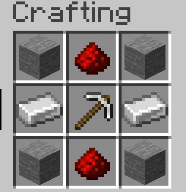

# cobblestone_breaker

This is a simple mod for a block that automatically breaks a cobblestone next to it if powered by redstone.

See the crafting recipe below: 

Icon and texture generated using [this pixelart generator](https://deepai.org/machine-learning-model/pixel-art-generator)

## License

This template is available under the CC0 license. Feel free to learn from it and incorporate it in your own projects.
